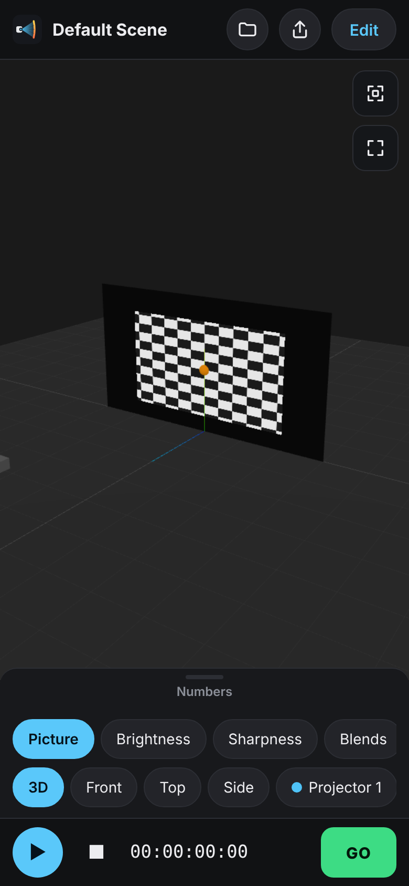
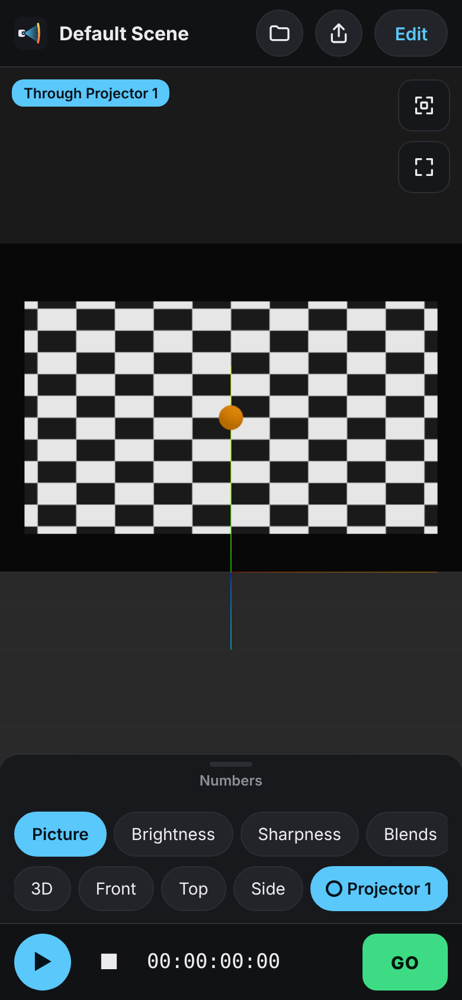
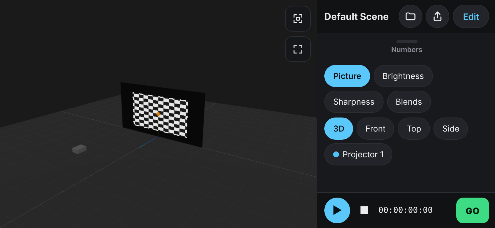

# v8 — easier on a phone, installable web app

## Phone viewer

* **Look through a projector**: the camera chips now list every projector. Tap one and the
  3D view sits at that projector's lens, aimed at the middle of its image (lens shift
  included) and zoomed so the whole image fits the phone screen. Tap it again, a camera
  preset or Fit to leave. Useful on site to hold the phone where the projector hangs.
* **Fit**: frames every screen, object and projector (the floor is left out).
* **Full screen**: hides everything but the 3D view; ✕ brings the controls back. On
  Android the browser bars go too; iPhone Safari has no page full screen, so there only
  the app's own bars hide (installed to the Home Screen it is full screen anyway).
* **Share** (header): the phone's share sheet (WhatsApp, AirDrop, Messages…) with the
  same `#view=` link as More → Copy link for phone. Falls back to copying the link.
* **Open** (header): open a saved project file on the phone.
* **Screen stays on while playing** (Wake Lock, where the browser has it).

## Phone on its side

A phone held sideways (touch screen, 500 px tall or less) now counts as a phone; before,
an iPhone on its side (844 px wide) got the tablet editor. In the viewer the 3D view takes
the left of the screen and the controls are a column on the right. "Numbers" replaces the
chips in that column.

## Editor on a phone

The playback-rate list is hidden on phones so the transport row fits and Cues is on
screen (rate stays on tablets and computers).

## Installable web app (PWA)

* `public/manifest.webmanifest` + icons in `public/icons/` (rendered from `logo.svg`):
  Add to Home Screen gives an app icon and opens without browser bars.
* `sw.js` is generated at build time (`tools/pwa/serviceWorker.mjs`, plugin in
  `vite.config.ts`) and precaches every built file, so the app opens with no network after
  one visit. Pages are network first (a phone with signal always gets the newest version);
  fingerprinted `assets/*` files are cache first. Old caches are dropped when a new
  version activates. Not registered in `npm run dev`.
* Projects, images and videos are stored exactly as before (browser storage); nothing
  about saving changed.

Tests: `e2e/v8.spec.ts`; `src/ui/deviceProfile.test.ts` covers the landscape rule.
