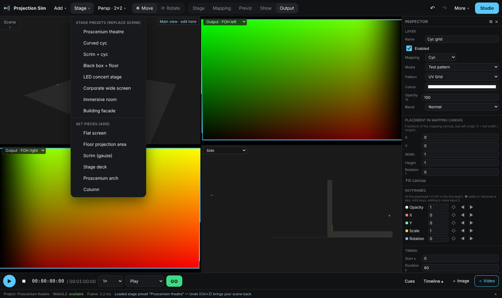
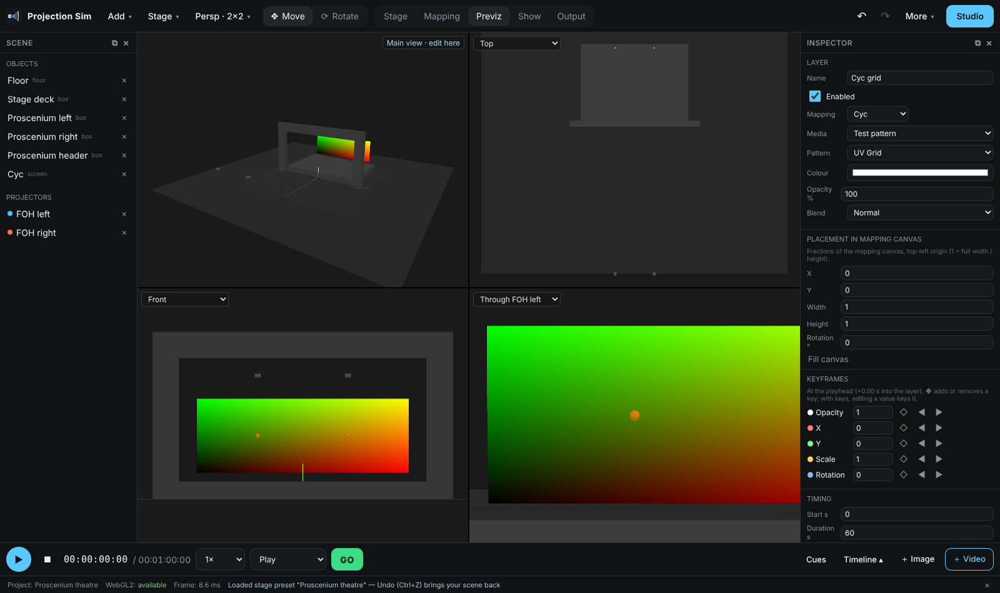
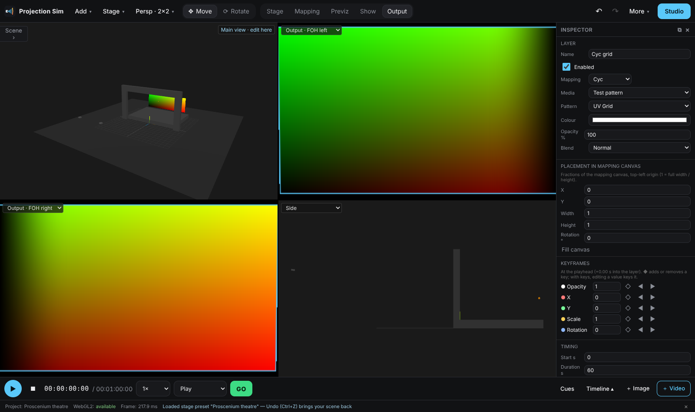

# v9 — stage presets, multiview and workspace modes

## Stage presets (toolbar → Stage)

Built-in, disguise-style stage templates. Picking one replaces the scene (Ctrl+Z brings the
old scene back). Each comes with set pieces, screens, projectors aimed with look-at and a
throw ratio worked out for the image size, a Direct mapping + UV grid layer per screen, and
a locked Perspective mapping per projector. With 2+ projectors, Composite switches to
Blend with auto (geometry) blending.

| Preset | What is in it |
| --- | --- |
| Proscenium theatre | Deck, proscenium arch (legs + header), flat cyc, 2 blended FOH projectors |
| Curved cyc | Deck and a 100° curved cyc, 3 projectors blended across it |
| Scrim + cyc | Gauze in front (light passes through it) and a rear-projected cyc |
| Black box + floor | Back wall, floor area lit from overhead, rostrum and cube that cast shadows |
| LED concert stage | Main LED wall, two projected IMAG screens, lighting truss |
| Corporate wide screen | 32:9 screen on a riser with a lectern, 2 blended projectors |
| Immersive room | Three walls and the floor, one projector each |
| Building facade | Facade with columns, 2 × 2 projector stack |

Set pieces (same menu) add one item to the current scene: flat screen, floor projection
area, scrim, stage deck, proscenium arch, column. New screens get a Direct mapping and are
added to every projector's locked Perspective mapping.

Specs are starting points (generic 16:10 / 16:9 bodies, 20,000 lm); pick real models in
Inspector → Model & lens.

## Multiview (View menu → Multiview layout)

Layouts: 1, 1|1, 1+3, 2×2. The first pane is the main view (gizmo, editing, Fly). Each
extra pane has a dropdown:

* Perspective, Top, Front, Side — Top / Front / Side are orthographic (plan and
  elevations), pan with drag and zoom with the wheel; Perspective orbits.
* Through *projector* — follows the projector's lens live.
* Output · *projector* — that projector's output feed.

Click in a pane selects an object; double-click re-frames it. Panes use the same renderer
and textures as the main view (drawn into the main canvas, copied to the pane), so there is
no second WebGL context. The layout is remembered in this browser, not in the project.

## Workspace modes (toolbar)

| Mode | Layout | Panels |
| --- | --- | --- |
| Stage | 1 view | Scene + Inspector |
| Mapping | 1|1, right = selected projector output | Studio on Mappings, Inspector |
| Previz | 2×2: main, Top, Front, through the selected projector | Scene + Inspector |
| Show | 1 view | Timeline + Cues, side panels hidden |
| Output | 2×2 (1|1 with one projector): main + up to 3 projector outputs | Inspector |

Modes only arrange the screen; nothing in the project changes.

## Code

* `src/stage/presets.ts` — presets, set pieces, `aimedProjector`, `showForScene`.
* `src/ui/multiview/layouts.ts` — layouts, pane views, workspace modes (pure).
* `src/scene/MultiviewPanes.ts` — pane cameras, controls, picking and rendering.
* Store: `applyStagePreset`, `addSetPiece`, `viewLayout`, `extraViews`, `workspaceMode`.
* Also fixed: Fit (`frameAll`) now runs after the scene is synced, so it frames a
  newly loaded scene instead of the previous one.

Tests: `src/stage/presets.test.ts`, `src/ui/multiview/layouts.test.ts`, `e2e/v9.spec.ts`.
